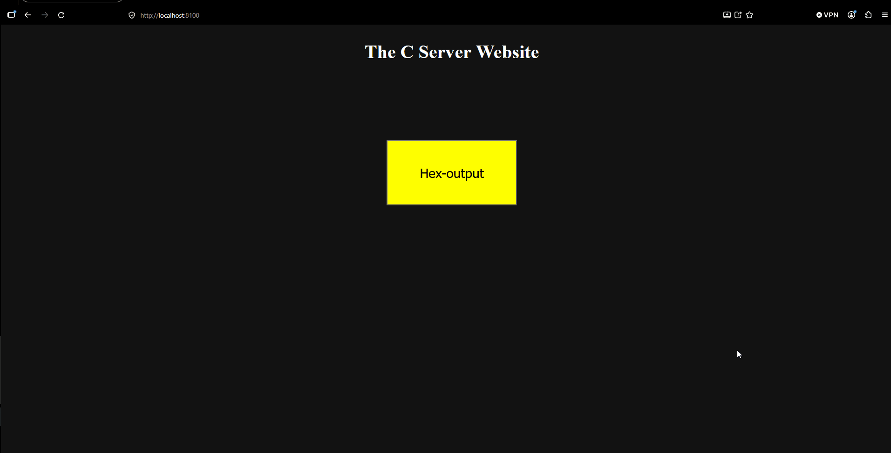

# TCP Server with Gateway and Frontend

## What it uses

Fully written in C, except for the frontend.
I dont use any libaries, but I do use the POSIX socket API, for which I need libaries.
- C and socket libaries
- Docker (that orchestrates the three servcies and uses nginx)

## The idea

This TCP server is actually not needed for the frontend.
My Idea was to have the frontend because of the WebDev aspect and 
for visualisation in the browser.

The http_gateway does the routing and can handle the frontend on its own.

Now I wanted the TCP to have a visual hex string rendered when a button gets pressed.
(That is a 32 random bytes string, represented in 64 hexadezimal)

That does work now, but you cant really know if its from the TCP server without using a  terminal or docker prints.
(Have to figure out something for that)


## How it works



#### Gif Explanation:

- You can see the button being pressed after the side loaded
- That renders the hex string send by the TCP over the http gateway
- The docker terminal output prints that the button was pressed and then sends some hexdata, and then for the frontend the json "hex": hexString


#### Detailed explanation:

The frontend (client) connects to the gateway and over pressing buttons or loading urls, certain routes like /api/visualization (the button route) or /index.html, things get loaded by the frontend after the data got send.

For the Hex string, the gateway calls the handle_visualization function which corresponds to a lookup table with the url of /api/visualization. That function has a tcp_call function, which sends and receives data from the TCP server after connecting. The TCP server generares a random string for that route call.

## How to run


### Prerequisites

- [Docker](https://docs.docker.com/get-docker/)
- [Docker Compose](https://docs.docker.com/compose/install/)

No C compiler, socket libraries, or additional dependencies need to be installed on the host machine. The C applications are compiled inside their respective Docker images.

### 1. Clone the repository

```bash
git clone https://github.com/Akuma-11001/TCP_Fullstack.git
cd TCP_Fullstack
```

Replace the repository URL with your own GitHub repository URL.

### 2. Build and start the containers

```bash
docker compose up --build -d
```

This builds and starts all three services:

- **tcp_server:** Handles TCP connections on port `8005`.
- **http_gateway:** Handles HTTP requests on port `9000` and communicates with the TCP server.
- **frontend:** Uses Nginx to serve the frontend and proxy API requests to the HTTP Gateway.

### 3. Open the website

Open the following address in your browser:

http://localhost:8100/

Press the visualization button to request a hexadecimal string from the TCP server.

### 4. View container logs (optional)

To see the communication between the services:

```bash
docker compose logs -f
```

To view the logs of an individual service:

```bash
docker compose logs -f tcp_server
docker compose logs -f http_gateway
docker compose logs -f frontend
```

### 5. Stop the containers

```bash
docker compose down
```

To rebuild the images after making code changes:

```bash
docker compose up --build -d
```

